# Vyapari Voice Copilot

**A multilingual voice operations copilot for small Indian retailers, powered by Gnani Prisma and Timbre.**

Vyapari turns Telugu + English shop-floor speech into safe, traceable business actions. A shopkeeper can check stock, record a sale, add stock, hear daily performance and receive demand-aware reorder suggestions without learning a complex point-of-sale interface.

## Why this is more than a voice chatbot

A normal voice chatbot only answers questions. Vyapari connects speech to an operational state machine:

1. The browser records a 16 kHz mono WAV command.
2. Gnani Prisma transcribes Indian-language and code-mixed speech.
3. A deterministic Go intent engine validates the command and identifies the product and quantity.
4. The transaction updates persistent inventory and sales data.
5. The analytics engine recalculates revenue, profit, top products, stock cover and reorder quantities.
6. Gnani Timbre speaks the result in Telugu or English.
7. Every change appears in a traceable activity timeline and can be undone.

## Main features

- Telugu + English and English voice commands
- Actual Gnani Prisma REST integration, not a simulated transcript
- Actual Gnani Timbre REST integration with Telugu and English voices
- Prisma v3.0 Indic auto-detection with automatic Prisma v2.5 fallback
- Browser-side 16 kHz WAV recording; no FFmpeg dependency
- Product-aware speech bias/keyterms for better recognition
- Sales recording, stock checks, restocking and undo
- Persistent local JSON data with atomic replacement
- Revenue, gross profit, orders, items sold and inventory-value metrics
- Seven-day sales trend and top-product ranking
- Demand-aware reorder quantities, stock-cover estimates and estimated purchase cost
- CSV exports for inventory and reorder planning
- Add-product workflow with multilingual voice aliases
- Local-first Go backend; the Gnani API key never reaches the browser
- Retry and rate-limit handling for programme API accounts
- Responsive installable PWA interface
- Typed-command fallback when microphone access is unavailable
- Synthetic seed data and one-click demo reset
- Unit tests for inventory transactions, intent parsing and Gnani request construction
- Docker and local run options

## Quick start

Read [START_HERE.md](START_HERE.md).

Minimal PowerShell steps:

```powershell
Copy-Item .env.example .env
notepad .env
go run .\cmd\server
```

Open `http://localhost:8080`.

## Commands to demonstrate

```text
Basmati rice stock entha undi?
Basmati rice rendu packets sale ayindi
Sunflower oil five bottles stock add
Low stock products cheppu
Ee roju sales entha?
How is my shop today?
Reorder list cheppu
Undo last action
```

## Technology

- **Backend:** Go standard library (`net/http`, JSON persistence, multipart proxying)
- **Speech-to-text:** Gnani Prisma via `POST https://api.vachana.ai/stt/v3`
- **Text-to-speech:** Gnani Timbre via `POST https://api.vachana.ai/api/v1/tts/inference`
- **Frontend:** HTML, CSS and vanilla JavaScript
- **Audio:** Web Audio API, PCM downsampling and WAV encoding in the browser
- **Data:** Local JSON state, protected by a read/write mutex

## Architecture

```mermaid
flowchart LR
    A[Shopkeeper speaks] --> B[Browser audio recorder]
    B -->|16 kHz WAV| C[Go API]
    C -->|Server-side API key| D[Gnani Prisma STT]
    D --> E[Code-mixed transcript]
    E --> F[Intent and product parser]
    F --> G[Inventory and sales engine]
    G --> H[Analytics and reorder engine]
    H --> I[Telugu or English response]
    I -->|Server-side API key| J[Gnani Timbre TTS]
    J --> K[Spoken reply + live dashboard]
```



See [ARCHITECTURE.md](ARCHITECTURE.md) for design decisions and trade-offs.

## API routes

| Method | Route | Purpose |
|---|---|---|
| GET | `/api/health` | Server and Gnani configuration status |
| GET | `/api/dashboard` | Metrics, products, trends and reorder plan |
| POST | `/api/stt` | Proxy a WAV recording to Gnani Prisma |
| POST | `/api/command` | Parse and execute a transcript or typed command |
| POST | `/api/tts` | Generate a Gnani Timbre WAV reply |
| POST | `/api/products` | Add a product and multilingual aliases |
| POST | `/api/stock` | Record a quick sale or restock |
| POST | `/api/undo` | Reverse the most recent reversible action |
| POST | `/api/reset` | Restore synthetic demo data |
| GET | `/api/export.csv` | Export inventory |
| GET | `/api/reorder.csv` | Export reorder recommendations |

## Test and verify

```powershell
go test .\...
go vet .\...
```

The project intentionally uses only the Go standard library, so there is no dependency download during normal compilation.

## Privacy and safety

- Use synthetic customer and shop data in the public demo.
- Never commit `.env` or expose the API key.
- The browser calls only the local Go backend; the API key is attached server-side.
- Uploaded voice clips are forwarded for transcription and are not written to disk by this application.
- This prototype is not an accounting, tax or financial-advice system.

## Challenge positioning

The project is designed to demonstrate:

- **Mixed-language voice experience:** Telugu + English shop commands
- **Real-world utility:** small-retail inventory and sales operations
- **Creative model use:** speech changes business state instead of only generating chat
- **Demo craft:** a visible voice-to-action-to-spoken-response loop
- **Engineering depth:** persistence, validation, analytics, testing, security and failure handling

See [SUBMISSION.md](SUBMISSION.md) and [DEMO_SCRIPT.md](DEMO_SCRIPT.md) for ready-to-customise submission material.
